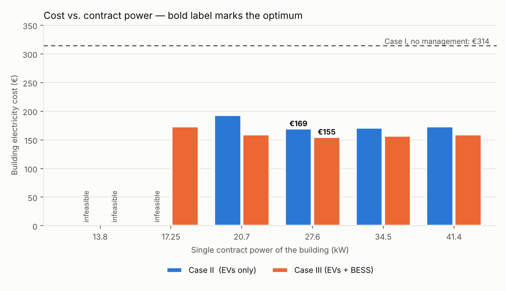
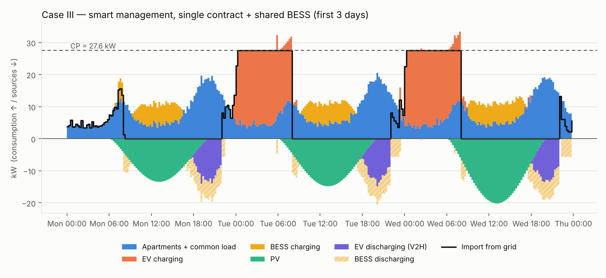

# Smart-building EMS: single contract power optimisation (MILP, Pyomo)

Energy management system for a multi-apartment building with rooftop PV, bidirectional
EVs and a shared battery (BESS). A building manager schedules EV and BESS charging and
picks **one contract power (CP) for the whole building** instead of one per apartment,
minimising the electricity bill. The problem is a mixed-integer linear program (MILP)
written in **Pyomo** and solved with **CBC** (GLPK or HiGHS also work).

The model reproduces the methodology of Foroozandeh et al. (2022), *Single contract power
optimization: A novel business model for smart buildings using intelligent energy
management*, Int. J. Electr. Power Energy Syst. 135, 107534.



## The three cases

| Case | Name | What changes |
|---|---|---|
| I | NSM | Reference. Each apartment has its own contract and PV; EVs charge at full power on arrival. No optimisation. |
| II | SMSCP | One building contract; the manager schedules EV charging **and** discharging (vehicle-to-home). MILP. |
| III | SMSCPB | Case II plus a shared 50 kWh BESS. MILP. |

For Cases II and III the CP is chosen by solving the MILP for each candidate value
(13.8 … 41.4 kW, as in the paper) and keeping the cheapest feasible one.

## Mathematical model (Cases II / III)

Time steps $t$ of length $\tau$ hours (15 min); apartments/EVs $j$; powers in kW, energy in kWh.

**Objective** (paper eq. 1)

$$\min\; c^{CP}\cdot CP\cdot N_{days} \;+\; \tau\sum_t \left(\lambda^{buy}_t\,p^{imp}_t - \lambda^{sell}_t\,p^{exp}_t\right)$$

**EV constraints**, only while EV $j$ is plugged in (eqs. 2–9):

$$0 \le p^{ch}_{t,j} \le P^{ch}\,\alpha_{t,j},\qquad 0 \le p^{dis}_{t,j} \le P^{dis}\,\beta_{t,j},\qquad \alpha_{t,j}+\beta_{t,j}\le 1,\quad \alpha,\beta\in\{0,1\}$$

$$e_{t,j} = e_{t-1,j} + \tau\left(\eta^{ch}p^{ch}_{t,j} - p^{dis}_{t,j}/\eta^{dis}\right),\qquad e_{a-1,j}=E^{init},\qquad 0\le e_{t,j}\le E^{max},\qquad e_{d-1,j}\ge E^{min,dep}$$

**BESS** (Case III, eqs. 14–19): the same structure with its own binaries, plus the
end-of-horizon condition $e^{B}_{T} \ge e^{B}_0$.

**Power balance** (eqs. 10/13) and **contract limits** (eqs. 11–12):

$$p^{imp}_t + (P^{PV}_t - p^{curt}_t) + \sum_j p^{dis}_{t,j} + p^{B,dis}_t = p^{exp}_t + \sum_j P^{A}_{t,j} + P^{C}_t + \sum_j p^{ch}_{t,j} + p^{B,ch}_t$$

$$p^{imp}_t \le CP,\qquad p^{exp}_t \le \tfrac12\,CP$$

The binaries stop simultaneous charging and discharging, which an LP would otherwise use
to burn energy in losses whenever that is profitable.

After solving, the bill is shared among apartments as in the paper's step (ii): each
apartment pays for its own net demand $P^A + p^{ch} - P^{PV} - p^{dis}$ at the buy/sell
price, and the remaining building costs (contract charge, common services, BESS) are split
in proportion to consumption (`results/apartment_costs.csv`).

## Results on the demo data (15 apartments, 1 week, 15-min)

| Case | Contract power | Cost (1 week) | Saving vs Case I |
|---|---|---|---|
| I – no management | 16 contracts, 158.7 kW in total | €314.27 | – |
| II – single CP | **27.6 kW** | €169.27 | **46.1 %** |
| III – single CP + BESS | 27.6 kW | €154.74 | **50.8 %** |

For comparison, the paper reports an optimal CP of 27.6 kW for Case II (43.7 % saving)
and 20.7 kW for Case III (47 % saving). Case II matches; in Case III the BESS here makes
17.25 kW feasible but 27.6 kW is still slightly cheaper, because the demo data and tariff
are synthetic (see *Assumptions*).



The schedule shows the expected behaviour: EVs charge at night when energy is cheap, up to
the contract limit; the BESS charges from midday PV surplus; and in the evening peak the
BESS and the parked EVs supply the building, so almost nothing is bought at the peak price.

## Assumptions and differences from the paper

The paper's building data and tariff tables are not public, so:

- **Data** is synthetic (`data_schema.make_synthetic`), built to the paper's structure:
  15 apartments, 3.6 kWp PV each (yield calibrated near the paper's ≈2,700 kWh/yr per
  apartment), one 27.2 kWh EV each (3.7 kW charge, 3.33 kW discharge), a 50 kWh BESS
  (6.3 / 5.67 kW), evening arrivals and morning departures.
- **Tariff**: bi-hourly, €0.10/kWh off-peak (22:00–08:00 and weekends) and €0.20/kWh
  peak; export €0.05/kWh.
- **Contract charge** $SCP(CP)$: €0.05 per kW per day. Configurable in `BuildingConfig`.
- **Efficiencies**: 95 % charge and discharge for EVs and BESS (not reported in the paper).
- **PV curtailment** is allowed. Without it, the export limit $CP/2$ can make sunny hours
  infeasible.
- **Case I** charges each EV to the same departure target used in Cases II/III, so all
  cases deliver the same energy to the cars and the comparison is fair.

## Limitations and next steps

- **Perfect foresight.** Loads, PV and EV times are known in advance. A real EMS would use
  forecasts and re-optimise in a rolling horizon (model predictive control).
- **No battery degradation cost.** Frequent vehicle-to-home cycling wears the tenants' EV
  batteries; a cost per kWh cycled would make the trade-off explicit.
- **Fixed tariff, no market.** The natural extension is to replace the bi-hourly tariff
  with day-ahead / intraday market prices (energy arbitrage) and add flexibility services.
- **CP by enumeration.** Fine for 6 candidates; selecting the tariff level with binary
  variables inside a single MILP would scale better.

## Repository layout

```
data_schema.py     BuildingConfig, StudyData, synthetic data generator, CSV I/O
ems_models.py      Case I calculation, Case II/III Pyomo MILP, solver wrapper, cost split
run_cases.py       CLI: runs the cases, CP sweep, writes results/ and figures
plots.py           CP-sweep and dispatch figures
tests/             physical-consistency tests (power balance, SoC, departure targets)
demo_data/         one synthetic week, 15-min resolution
results/           outputs of the demo run
```

## Usage

```bash
pip install -r requirements.txt
conda install -c conda-forge coincbc        # or: apt install coinor-cbc; or use HiGHS (pip highspy)

python run_cases.py                          # all cases on demo_data, CBC/GLPK/HiGHS auto-detected
python run_cases.py --case III --solver glpk
python run_cases.py --regenerate --days 14   # new synthetic data
python -m pytest -q tests
```

To use your own data, write the same CSV/JSON files as in `demo_data/` (one column per
apartment, a regular time index) and pass `--data <folder>`. The step length is inferred
from the time index.

## License

MIT, see [LICENSE](LICENSE).
